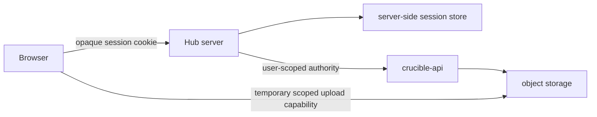

# Crucible Hub Architecture

Status: Active implementation contract

Date: 2026-09-16

## Scope and authority

This document owns Hub runtime boundaries, execution model, security posture, and technical gates. [`product-brief.md`](product-brief.md) owns product behavior and [`../decisions/`](../decisions/) own durable choices. [`api-integration.md`](api-integration.md), [`design-system.md`](design-system.md), and [`authentication-transition.md`](authentication-transition.md) own their respective detailed contracts.

Hub owns browser presentation, interaction, sessions, client state, and bounded web-specific aggregation. `crucible-api` owns authorization, persistence, ingestion, resource semantics, and the OpenAPI contract. Hub capabilities guide presentation only. The API authorizes every operation.

| Concern                                               | Authority                                             |
| ----------------------------------------------------- | ----------------------------------------------------- |
| HTTP contract, authorization, and pagination          | `crucible-api` and its deterministic OpenAPI artifact |
| Python and CLI                                        | `nano-crucible`                                       |
| Mobile-local behavior                                 | `crucible-lens`                                       |
| Bounded sample and dataset resource graph behavior    | `crucible-hub`                                        |
| Advanced graph and specialized viewers until migrated | `crucible_graph_explorer`                             |
| Cross-repository ownership and compatibility          | `crucible-ecosystem`                                  |
| Hub web behavior, sessions, and design system         | `crucible-hub`                                        |

Scientific dataset viewers use a build-time Hub registry with lazy browser modules and a stable viewer route. The API and ingestion systems own typed versioned representation discovery, authorization, server-heavy parsing, and durable derived artifacts. Hub owns the viewer shell and browser interaction and does not execute Python scientific parsing, remote viewer code, or third-party viewer frames. See decision 0030.

## Runtime and trust boundaries

- Browser input is untrusted. The browser owns rendering, navigation, forms, table state, TanStack Query, safe preferences, and direct upload bytes.
- The browser never receives or persists the credential used to authenticate ordinary Hub requests. An administrator may receive a newly created or rotated service-account key once in mutation-local memory. Service-account keys, signed download links, and upload capabilities never enter Query data, storage, logs, telemetry, URLs, screenshots, or server-rendered output.
- The Hub server owns session handling, authenticated API calls, boundary validation, CSRF and same-origin enforcement, safe errors, bounded aggregation, and redacted observability. It is a backend for the frontend, not a second domain backend.
- Production sessions use opaque browser IDs and encrypted, shared server-side state supporting expiry, revocation, rotation, and replicas. Process-local or file-backed stores are local-development only.
- The API owns identities, permissions, mutation truth, and representations. Object-storage capabilities use the smallest supported scope and lifetime. Explorer is a reference, never a runtime authentication or navigation dependency.

The selected stack is TypeScript and React, TanStack Start and Router, TanStack Query and Form, shadcn/ui with Tailwind and Base UI primitives, `openapi-fetch` with generated types, React Flow with ELK, Vitest, and Playwright. Current collections use semantic tables and API-owned pagination without a table or virtualization package. The local runtime and server boundary are verified; production authentication, sessions, uploads, and deployment remain gated separately.

## Module and execution boundaries

Browser-reachable routes and features compose domain components and identity-scoped Query options. They call validated server functions, which authenticate and call the server-only API adapter backed by generated code. `components/ui` never imports features, generated code never imports application code, and browser-reachable modules never import sessions or API transport. `npm run boundary:check` is the canonical negative production-build proof.

Ordinary loaders are isomorphic. They must not read credentials, sessions, or the API client. Use authenticated server functions for application reads and mutations; reserve server routes for external callers, raw or streaming responses, callbacks, and health endpoints. Validate route/search input and server-function input separately, propagate abort signals, and select API origins only from trusted server configuration.

Generated API output is reproducible and never hand-edited. The adapter may provide trusted base URL selection, user authorization, aborts and timeouts, safe decoding, and redacted metrics. It must not recreate authorization, rename a second wire contract, or silently compensate for an API mismatch. Detailed generation, error, endpoint, and cache rules are in [`api-integration.md`](api-integration.md).

## Authentication and identity

Production authentication remains blocked on the API-owned one-time authorization-code exchange and the proposed server-side session boundary. The required flow is state, nonce, and PKCE transaction storage; an allowlisted callback; single-use, short-lived code exchange; encrypted server-side user authority; session-ID rotation; and an opaque `HttpOnly`, `Secure`, `SameSite=Lax` cookie. Private server functions authenticate independently, route guards are user experience only, mutations enforce same-origin and CSRF protection, logout revokes the server session, and credential or privilege changes invalidate affected sessions. Normal Hub requests never use a platform-administrator credential.

Until cutover, local development may explicitly use `HUB_DATA_SOURCE=api`. Server-only code reads trusted process configuration and a developer's user-scoped key per request; browser code receives neither the key nor a configurable API origin. This mode is rejected in production and fixtures remain the default. [`authentication-transition.md`](authentication-transition.md) owns the full development seam, acceptance evidence, cutover, rollback, and removal criteria.

Routes, cache keys, pins, history, and relationships use stable MFIDs. Slugs are lookup inputs and labels, resolved before canonical navigation. Search parameters are schema-validated and hold only shareable state such as filters, sorting, tabs, cursors, and graph focus. Drafts, menus, transient progress, and resource records stay out of URLs. Fixture scenarios use validated inherited search and distinct identity scope; non-default scenarios are unavailable in production.

The inspector uses the validated preview MFID and a shared detail Query, never resource history state or a competing cache. Lightweight row identity may render the pending title without seeding the detail cache or starting another request. It does not prefetch adjacent resource details. Route wrappers own validated search and collection inputs. Preview changes cannot refresh or change a collection. Interactive outside targets complete their own action without also starting a preview-history transition. [Decisions 0008](../decisions/0008-inspect-linked-resources-in-place.md), [0010](../decisions/0010-inspect-project-data-in-place.md), and [0012](../decisions/0012-inspect-global-data-in-place.md) own inspector behavior and privacy constraints.

Canonical sample and dataset pages may consume an ephemeral sibling session established by the collection or relationship surface that opened them. The app-level provider retains only lightweight sibling identities, a concise context and order label, cursor-boundary state, and Query-owned continuation callbacks. Route history carries an opaque session token rather than rows, filters, or callbacks. Known sibling navigation starts the selected route's normal exact-detail load and does not prefetch adjacent details. Originating collections extend through their existing Infinite Query continuation. A sequence rebuilt around the current resource issues two independently cached anchored reads with identical scope, filters, and sort and opposite directions, reverses the preceding side, removes the duplicate anchor, and retains each ordinary `next_cursor` for its respective boundary. Anchored sibling reads omit the optional exact total because the compact control does not surface sequence positions. Reaching either loaded boundary follows that direction's cursor without resending the anchor. Account or server identity replacement remounts the provider, while reload safely omits sibling navigation. Hub never scans preceding cursor chains or reorders incomplete loaded pages.

## Server state and UI transitions

TanStack Query is the sole browser owner of Crucible server state. Loaders use `ensureQueryData`, prefetch the same Query options, or provide non-overlapping shell data. Every authenticated key begins with server and stable account identity, followed by family, canonical MFID, representation, and normalized parameters. Include server identity even though only the hosted API is initially available.

- Collection rows are lightweight and never overwrite richer detail. Detail may project safely into a compatible collection only through tested code.
- Query freshness follows volatility and workflow. Cached readable data renders during refresh; refresh and pagination failures remain local with retry. Initial skeleton, empty, unavailable, and error states are distinct.
- Pagination placeholder data requires the same server and account scope. Replacing server, account, login state, credentials, or logging out replaces the entire Query client before another identity renders. Clearing queries alone does not reset inspector navigation ownership.
- Query persistence is deferred pending a privacy, retention, expiry, logout, and multi-account isolation decision. Credentials, including one-time service-account keys, signed links, authorization codes, and upload secrets never enter Query or dehydration.
- Recently viewed resources are client UI state rather than server state. The persistent application shell keeps only resource kind, MFID, current display name, available project ID, and last-viewed timestamp in React memory, scopes the list to the active account, and discards it on reload or account replacement. It does not use Query, URL state, local storage, session storage, cookies, telemetry, or server rendering.

Use nested routes for persistent entity identity. Parent identity, breadcrumbs, heading, and local navigation remain mounted while child pending and errors stay in the outlet. Essential identity and detail reads use `ensureQueryData`; recoverable collections prefetch and await only when no readable data exists. Search, filters, sort, tabs, and pagination inside an established page update content rather than replacing the shell or page context. [Decision 0007](../decisions/0007-coordinate-route-and-query-loading.md) defines this loading boundary.

## Writes and workflows

Server functions validate intent, authenticate, call the API, return the minimum confirmed representation, update exact cache data, and invalidate only dependent views. Failed fields, rows, panels, files, and workflow steps retain their drafts and readable context. Optimism is allowed only with deterministic rollback that cannot misrepresent authority or scientific provenance. ACL changes, ownership transfer, project moves, relationships, deletion, uploads, and metadata default to server-confirmed state.

Multi-stage create, relationship, upload, thumbnail, and ingestion workflows record only safe completed-stage identifiers returned by the API. Hub omits canonical MFIDs from creation input and locks structural creation after a confirmed response. It does not automatically retry an uncertain create because the API has no idempotency contract; it retains the draft and directs the user to check Data before resubmitting. After confirmation, a retry starts at the first incomplete relationship or file stage and never recreates a durable resource. Secrets and signed URLs are reacquired, not checkpointed.

Canonical sample and dataset routes share one generic detail representation but retain type-specific paths. Descriptive edits, scientific metadata, deletion requests, project and instrument management, direct membership, access, lifecycle, operators, ownership, registration, and assignments are independent workflows. Use the decisions for their UI and mutation constraints. Project and instrument descriptive edits replace their read-only Overview card after an explicit capability-gated action. Instrument lifecycle is a route-backed Manage subsection gated by `can_change_status`; it uses the dedicated status operation, confirms decommissioning, and applies no optimistic state. Instrument operators use the dedicated list, add, and remove operations, resolve candidates through service-account-only identity autocomplete, replace the complete returned operator list, and confirm removal. Instrument registration is a dedicated capability-gated presentation route that omits owner and trusts the returned canonical MFID. Direct project membership is implemented for fixture and local-development work: add existing users immediately, cap service-account choices at Viewer and Contributor, change roles, remove members, or self-leave through the API contract. It has no invitation workflow and must not be exposed in production until session authentication is accepted and deployed.

Service-account administration is capability-gated at the route and presentation layers while the API authorizes every request. Directory and detail representations are identity-scoped Query state and exclude secret keys. Creation and rotation return a key through no-store server functions directly into mutation-local component state, and closing the one-time credential dialog clears it. Platform-role mutation additionally requires the caller's explicit human principal type because the API rejects service-account callers even when they hold the Admin platform role. The authoritative response replaces exact detail and dependent lists refresh, while the interface discloses the API's delayed cross-process authorization propagation. The Hub does not retrieve existing keys, persist secrets, or infer platform authority from a target's `is_service_account` value.

Dataset thumbnails are an independent identity-scoped Query representation. Overview starts the read only after browser hydration, and Graph requests first previews only for its bounded dataset-node set. Base64 image payloads do not enter resource detail, collection, loader, URL, persistence, or server-rendered dehydration state. Hub accepts only the API's normalized `image/jpeg` response, bounds returned payloads, applies `no-store`, and renders images through the shared thumbnail component. Add, rename, and delete use a separate server function, exact `can_edit` presentation guidance, API authorization, server-confirmed list replacement, and explicit delete confirmation. Hub never interprets image content or accepts an API-provided MIME type other than normalized JPEG.

Ownership transfers and sample or dataset project moves use API preview before explicit confirmation as defined by decision 0024. Project moves resolve a selected project MFID to its current project ID at the server boundary. Dataset acquisition-instrument assignment uses the dedicated `PUT /datasets/{dsid}/instrument` operation after local confirmation because the API provides no preview. Confirmed responses update only represented fields before dependent Query invalidation, and none of these operations uses optimistic state.

Resource relationship management is a canonical-page workflow for supported sample and dataset parent-child and cross-type associations. Direction is explicit, add uses a bounded type search in an accessible dialog, and unlink is confirmed without deleting either resource. The source's exact `can_edit` capability guides presentation, but the API authorizes both source and target. After mutation the current adapter rereads authoritative exact source and target relationship representations; Hub applies no optimistic update and replaces only those exact detail caches because lightweight collections do not contain relationships. The inspector remains read-only. Self-links, invalid pairs, duplicates, cycles, and target validation are API-defined errors, not client-invented authorization. Production exposure waits for the relationship-specific capability, error, validation, and typed response contract; local API-key development does not waive the production authentication gate.

Resource management uses route-backed `/samples/:sampleMfid/manage` and `/datasets/:datasetMfid/manage` children under a shared canonical resource shell. The parent keeps the persistent header and Overview, Graph, and Manage navigation mounted. ACL data is requested only on Manage entry, with preload disabled. Exact `can_manage_access` controls the access surface, including project assignment; exact `can_transfer` controls ownership transfer. Reviewed deletion remains available without inferred capability guidance and relies on API authorization. Overview Summary presents the current project and acquisition instrument as read-only context. Public controls are separate, and user or project grants cannot exceed `max_grant_role`. Owner, service-account, instrument, system, and unknown principals are read-only. The project grant matching the resource's canonical primary-project MFID is also read-only and is replaced only through atomic project assignment. Publish, unpublish, revoke, assignment, ownership transfer, and deletion requests require their established confirmation flows. Server-confirmed mutations replace authoritative state with no optimistic update. Legacy `/access` routes redirect to Manage.

## Errors, privacy, and deployment

Browser errors distinguish validation, authentication, forbidden, not found, conflict, rate limiting, cancellation, timeout, upstream failure, unexpected contract failure, and partial success. The server returns a stable safe envelope with a generated correlation ID, safe message, category, retry guidance, and safe field details. It never exposes credentials, internal URLs, raw upstream bodies, or stack traces. Detailed mapping is in [`api-integration.md`](api-integration.md).

QR scanning is an explicit browser-only camera workflow. Hub requests camera permission only after the person selects the application-bar Scan QR code action, decodes frames locally with a lazily loaded scanner, accepts only a valid MFID or a valid MFID from a trusted Crucible resource link, and always forces a fresh API read through the generic resource resolver before canonical navigation. The trusted link contributes only its MFID; its path cannot choose the resulting resource type. Camera frames and raw decoded values are never uploaded, stored, added to URLs, sent to telemetry, or placed in Query. Closing the dialog, choosing manual entry, completing a scan, or unmounting the scanner stops the media stream. Camera access requires a secure context and retains the browser's native permission controls. This local-only handling is the privacy decision for the workflow; image upload remains out of scope.

Every Hub request gets a server-generated correlation ID in request context and `X-Correlation-ID`; Hub does not trust browser values. The current API contract has no correlation header, so Hub-to-API propagation is pending a published contract. Telemetry may contain route or API templates, status, category, duration, size, cache outcome, retry count, and non-secret upload progress. It must exclude keys, sessions, cookies, codes, signed URLs, raw search text by default, scientific metadata, file content, emails, and complete bodies. User identifiers require a privacy decision.

The initial deployment is a non-root containerized Node runtime at `/hub`, separate from `/explore`. Vite and Nitro base paths must stay aligned, and the edge routes only `/hub` to this container. Untrusted forwarded host and protocol headers never influence rendering or security decisions. Authentication callbacks and secure-cookie proxy handling require an explicit trusted-proxy topology. Production checks cover prefixed assets, deep links, health, untrusted forwarded headers, server-function navigation, shutdown, and Docker health; authenticated replicas and target-edge validation remain blocked on authentication and deployment decisions.

## Gates and open questions

`npm run validate` is the canonical static and production-build gate. `npm run format:check`, `npm run docs:check`, `npm run secrets:check`, `npm run boundary:check`, `npm run test:browser`, `npm run test:production`, and `npm run audit` supply focused evidence. The local TanStack Start foundation has server-only import protection, safe Query hydration, cancellation and error propagation, container runtime checks, `/hub` behavior, and a server-function and browser test harness. Production readiness additionally requires per-function authentication through the accepted session boundary, mutation CSRF evidence, shared sessions, target deployment validation, and direct resumable upload feasibility before upload is exposed. A blocking architectural failure requires a documented reconsideration and new decision record.

Open questions are the API authorization-code exchange, production session and key management, SSR extent, safe preference storage, API-backed dashboard aggregates, upload browser and file-size support, and release performance, accessibility, and availability budgets.
