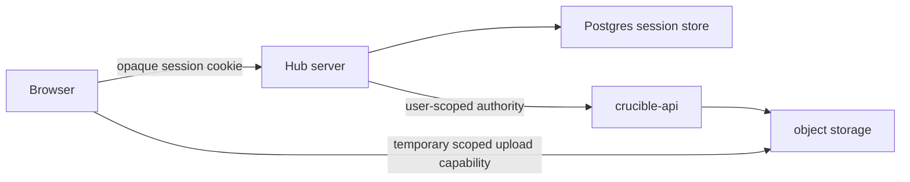

# Crucible Hub architecture

This document owns Hub runtime boundaries, execution model, security posture, and validation gates. [`product-brief.md`](product-brief.md) owns product behavior and [`../decisions/`](../decisions/) own durable choices. [`api-integration.md`](api-integration.md), [`design-system.md`](design-system.md), and [`authentication.md`](authentication.md) own their detailed contracts.

## Scope and authority

Hub owns browser presentation, interaction, sessions, client state, and bounded web-specific aggregation. `crucible-api` owns authorization, persistence, ingestion, resource semantics, and the OpenAPI contract. Hub capabilities guide presentation only; the API authorizes every operation.

| Concern                                            | Authority                                             |
| -------------------------------------------------- | ----------------------------------------------------- |
| HTTP contract, authorization, and pagination       | `crucible-api` and its deterministic OpenAPI artifact |
| Python and CLI                                     | `nano-crucible`                                       |
| Mobile-local behavior                              | `crucible-lens`                                       |
| Hub web behavior, sessions, and design system      | `crucible-hub`                                        |
| Bounded sample and dataset resource graph behavior | `crucible-hub`                                        |
| Advanced graph and specialized viewers             | `crucible_graph_explorer`                             |
| Cross-repository ownership and compatibility       | `crucible-ecosystem`                                  |

Scientific dataset viewers use a build-time Hub registry with lazy browser modules and a stable viewer route. The API and ingestion systems own typed representation discovery, authorization, server-heavy parsing, and derived artifacts. Hub owns the viewer shell and browser interaction and does not run Python parsing, remote viewer code, or third-party viewer frames ([decision 0030](../decisions/0030-load-scientific-viewers-from-a-typed-registry.md)).

## Runtime and trust boundaries

- Browser input is untrusted. The browser owns rendering, navigation, forms, table state, TanStack Query, safe preferences, and direct upload bytes.
- The browser never receives or persists the credential that authenticates ordinary Hub requests. An administrator may receive a newly created or rotated service-account key once, in mutation-local memory. Service-account keys, signed download links, and upload capabilities never enter Query data, storage, logs, telemetry, URLs, screenshots, or server-rendered output.
- The Hub server owns sessions, authenticated API calls, boundary validation, CSRF and same-origin enforcement, safe errors, bounded aggregation, and redacted observability. It is a backend for the frontend, not a second domain backend.
- Sessions use opaque browser IDs and keep API tokens server-side in a Hub-owned Postgres database; see [authentication](authentication.md).
- The API owns identities, permissions, mutation truth, and representations. Object-storage capabilities use the smallest supported scope and lifetime. Explorer is a reference, never a runtime dependency.

The stack is TypeScript and React, TanStack Start and Router, TanStack Query and Form, shadcn/ui with Tailwind and Base UI primitives, `openapi-fetch` with generated types, React Flow with ELK, CodeMirror 6 for the lazily loaded JSON editor, Vitest, and Playwright. Collections use semantic tables and API-owned pagination without a table or virtualization package.

## Module and execution boundaries

Browser-reachable routes and features compose domain components and identity-scoped Query options. They call validated server functions, which authenticate and call the server-only API adapter backed by generated code. `components/ui` never imports features, generated code never imports application code, and browser-reachable modules never import sessions or API transport. `npm run boundary:check` is the negative production-build proof.

Ordinary loaders are isomorphic and must not read credentials, sessions, or the API client. Use authenticated server functions for application reads and mutations; reserve server routes for external callers, raw or streaming responses, callbacks, and health. The file-open redirect in [decision 0034](../decisions/0034-open-stored-files-inline.md) is the one private, data-bearing server route; it authenticates through the request session and only issues a read redirect. Validate route/search input and server-function input separately, propagate abort signals, and select API origins only from trusted server configuration.

Client code ships as route chunks plus `vendor` and `shared` groups (third-party code and common `src/components`, `src/lib`, and `src/data` modules), configured in `vite.config.ts`. Heavy optional code (graph canvas and ELK worker, form library and edit forms, QR rendering) stays in on-demand chunks and must not be pulled into those groups. Optional components load through `React.lazy` via `lazyNamed` in `src/lib/lazy-named.ts`, whose `preload()` may run on hover, focus, or touch of the control that reveals them, so a warmed component renders without a Suspense fallback; warm-ups load code only, never data. Static assets are pre-compressed at build time; dynamic responses are left to the reverse proxy, as described in [response compression](releases.md#response-compression).

Generated API output is reproducible and never hand-edited. The adapter may provide trusted base URL selection, user authorization, aborts and timeouts, safe decoding, and redacted metrics. It must not recreate authorization, rename a second wire contract, or silently compensate for an API mismatch. Generation, error, and cache rules are in [`api-integration.md`](api-integration.md).

## Authentication and identity

Sign-in uses the API's standard OAuth authorization-code flow with state, PKCE, an exact callback, server-side tokens, refresh coordination, and revocation on sign-out. Private server functions authenticate independently, route guards are user experience only, mutations enforce same-origin and CSRF protection, and credential or privilege changes invalidate affected sessions. [`authentication.md`](authentication.md) owns data sources, session settings, and the development API-key mode.

The Hub sends explicit normal privilege mode by default. The global Administrator view is the only source of elevation: an eligible human administrator turns it on deliberately, and only then do requests carry elevated authority, administration destinations appear, and elevated actions show on resources. Administration server functions refuse with `403` while it is off instead of elevating on their own ([decision 0031](../decisions/0031-scope-administrator-authority.md)).

Routes, pins, history, and relationships use stable MFIDs. Query identity includes server, account MFID, and effective privilege mode so normal and elevated representations cannot collide. Slugs are lookup inputs and labels, resolved before canonical navigation. Search parameters are schema-validated and hold only shareable state such as filters, sorting, tabs, cursors, and graph focus. Drafts, menus, privilege mode, transient progress, and resource records stay out of URLs. Fixture scenarios use validated inherited search and distinct identity scope and are unavailable in production.

The inspector uses the validated preview MFID and a shared detail Query, never resource history state or a competing cache. Lightweight row identity may render the pending title without seeding the detail cache or starting another request, and adjacent details are not prefetched. Preview changes cannot refresh or change a collection, and interactive outside targets complete their own action without starting a preview-history transition. [Decisions 0008](../decisions/0008-inspect-linked-resources-in-place.md), [0010](../decisions/0010-inspect-project-data-in-place.md), and [0012](../decisions/0012-inspect-global-data-in-place.md) own inspector behavior.

Canonical sample and dataset pages may consume an ephemeral sibling sequence established by the collection or relationship surface that opened them. The app-level provider keeps only lightweight sibling identities, a context label, cursor-boundary state, and Query-owned continuation callbacks; route history carries an opaque token rather than rows, filters, or callbacks. Originating collections extend through their existing Infinite Query. A sequence rebuilt around the current resource issues two anchored reads with identical scope, filters, and sort in opposite directions, removes the duplicate anchor, omits the exact total, and follows each side's `next_cursor` without resending the anchor. Account or server replacement remounts the provider, and reload falls back to the saved default. Hub never scans preceding cursor chains or reorders incomplete pages.

## Server state and UI transitions

TanStack Query is the sole browser owner of Crucible server state. Loaders use `ensureQueryData`, prefetch the same Query options, or provide non-overlapping shell data. Every authenticated key begins with server and stable account identity, followed by family, canonical MFID, representation, and normalized parameters.

- Collection rows are lightweight and never overwrite richer detail. Detail may project into a compatible collection only through tested code.
- Freshness follows volatility and workflow. Cached data renders during refresh; refresh and pagination failures stay local with retry. Initial skeleton, empty, unavailable, and error states are distinct.
- Placeholder data across pagination, filter, and sort changes requires the same server and account scope. Replacing server, account, login state, or credentials, or logging out, replaces the entire Query client before another identity renders.
- Query persistence is not used. Credentials, one-time service-account keys, signed links, authorization codes, and upload secrets never enter Query or dehydration.
- Recently viewed resources are client UI state: kind, MFID, display name, project ID, and last-viewed time in React memory, scoped to the active account and discarded on reload or account replacement.
- Timestamps cross the API boundary as UTC instants and display in the viewer's time zone; offset-free values are read as UTC. Date filters convert the viewer's local day to UTC bounds on the server using the IANA zone in the non-`HttpOnly` `crucible_hub_time_zone` cookie (path `/hub`, one year, `SameSite=Lax`), falling back to a labeled UTC rendering until hydration when it is absent.
- Presentation preferences are server-rendered from non-`HttpOnly` cookies with the same attributes: `crucible_hub_theme`, `crucible_hub_sidebar`, `crucible_hub_inspector`, and `crucible_hub_window`. The root route reads them once in `beforeLoad` and exposes them through `useViewerPresentation()`; a head script resolves the `system` theme before first paint.

Use nested routes for persistent entity identity: parent identity, breadcrumbs, heading, and local navigation stay mounted while child pending and error states stay in the outlet. Search, filters, sort, tabs, and pagination inside a page update content without replacing the shell. The router uses an infinite default stale time, so loader-side validation such as MFID existence and 404 handling runs once per matched route per client session and stale detail refreshes only through Query invalidation ([decision 0007](../decisions/0007-coordinate-route-and-query-loading.md)).

## Writes and workflows

Server functions validate intent, authenticate, call the API, return the minimum confirmed representation, update exact cache data, and invalidate only dependent views. Failed fields, rows, panels, files, and workflow steps keep their drafts and readable context. Optimism is allowed only with deterministic rollback that cannot misrepresent authority or provenance; ACL changes, ownership transfer, project moves, relationships, deletion, uploads, and metadata use server-confirmed state.

Multi-stage create, relationship, upload, thumbnail, and ingestion workflows record only safe completed-stage identifiers. Hub omits MFIDs from creation input ([decision 0025](../decisions/0025-let-api-assign-creation-mfids.md)) and never automatically retries an uncertain create, because the API has no idempotency contract; it keeps the draft and directs the person to check Data. After confirmation, a retry starts at the first incomplete stage and never recreates a resource. Secrets and signed URLs are reacquired, not checkpointed.

Each management workflow has its own decision record for UI and mutation constraints:

| Workflow                                                     | Decision                                                                                                                                      |
| ------------------------------------------------------------ | --------------------------------------------------------------------------------------------------------------------------------------------- |
| Resource Manage routes, access, ownership, project placement | [0028](../decisions/0028-consolidate-resource-management.md), [0024](../decisions/0024-preview-ownership-and-project-moves.md)                |
| Relationships                                                | [0022](../decisions/0022-manage-resource-relationships.md)                                                                                    |
| Deletion requests and review                                 | [0019](../decisions/0019-request-resource-deletion-through-review.md)                                                                         |
| Project and instrument editing and lifecycle                 | [0027](../decisions/0027-edit-projects-and-instruments-from-overview.md), [0023](../decisions/0023-manage-instrument-lifecycle-separately.md) |
| Project membership                                           | [0021](../decisions/0021-adopt-direct-project-membership-contract.md)                                                                         |
| Scientific metadata                                          | [0018](../decisions/0018-edit-scientific-metadata-as-json.md)                                                                                 |

Cross-cutting rules for these workflows:

- Exact capabilities (`can_edit`, `can_manage_access`, `can_transfer`, `can_review`, `can_change_status`) guide presentation only. Hub never derives authority from a project role, account role, or route location.
- Ownership transfers and project moves preview through the API before confirmation. Operations the API cannot preview, such as dataset instrument assignment, use local confirmation.
- Relationship changes reread the exact source and target representations and replace only those detail caches; lightweight collections do not contain relationships.
- Deletion review is server-confirmed. Success invalidates affected resources, project and instrument summaries, search, graphs, and request queues. The platform-wide deletion audit is read only while the Administrator view is on.
- Service-account keys return from no-store server functions into mutation-local state and are cleared when the one-time dialog closes. Hub never retrieves existing keys or infers platform authority from `is_service_account`. Platform-role changes require a human caller because the API rejects service-account callers.
- Dataset thumbnails are a separate identity-scoped Query, read only after hydration. Hub accepts only the API's normalized `image/jpeg` payload, bounds its size, applies `no-store`, and keeps base64 images out of detail, collection, loader, URL, and dehydrated state.

## Errors, privacy, and deployment

Browser errors distinguish validation, authentication, forbidden, not found, conflict, rate limiting, cancellation, timeout, upstream failure, unexpected contract failure, and partial success. The server returns a stable safe envelope with a correlation ID, safe message, category, retry guidance, and safe field details, never credentials, internal URLs, raw upstream bodies, or stack traces. Mapping details are in [`api-integration.md`](api-integration.md).

QR scanning is a browser-only camera workflow. Hub requests camera permission only after the person chooses Scan QR code, decodes frames locally with a lazily loaded scanner, accepts only an MFID or the MFID from a trusted Crucible resource link, and forces a fresh API read through the generic resource resolver before navigating. Camera frames and decoded values are never uploaded, stored, put in URLs, sent to telemetry, or placed in Query, and every exit path stops the media stream.

Every Hub request gets a server-generated correlation ID in request context and `X-Correlation-ID` (`src/start.ts`); Hub does not trust browser values and does not forward the ID to the API. Telemetry may contain route or API templates, status, category, duration, size, cache outcome, retry count, and non-secret upload progress. It excludes keys, sessions, cookies, codes, signed URLs, raw search text, scientific metadata, file content, emails, and complete bodies.

Hub runs as a non-root containerized Node server under `/hub`. Vite and Nitro base paths stay aligned, and the edge routes only `/hub` to this container. Untrusted forwarded host and protocol headers never influence rendering or security decisions; the public Hub origin comes from the configured callback URL and the number of trusted proxy hops from `HUB_TRUSTED_PROXY_HOPS`. [`releases.md`](releases.md) covers release images and post-deployment checks, and [self-hosting](../deploy/compose/README.md) covers Docker Compose.

## Validation gates

`npm run validate` is the full static and production-build gate; `npm run validate:static` omits only the build. CI runs the static and unit gate in parallel with one browser job that installs Chromium, runs the functional browser suite, builds once, and exercises the production Node runtime (`npm run test:production`). Failure reports and traces are kept only when a browser job fails. Screenshots are local review artifacts and are never generated or committed by CI. The focused commands are listed in [`CONTRIBUTING.md`](../CONTRIBUTING.md#commands).

A blocking architectural failure requires a new decision record.
