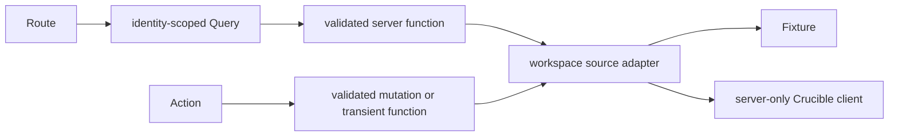

# Authentication Transition

Status: Active migration contract

Date: 2026-09-04

## Scope and current boundary

This document preserves independently testable Hub development while the API-owned login exchange is unavailable and defines its cutover to server-side sessions proposed by [decision 0002](../decisions/0002-server-side-session-boundary.md). The temporary local API-key bridge is development infrastructure only. It must not shape feature APIs, reach browser code, or become production behavior. During this bridge, a browser-session `HttpOnly`, `SameSite=Lax` intent cookie may select the API's explicit global privilege mode. The cookie contains no credential, does not grant authority, and is still checked by the API against the configured human administrator credential on every elevated request. Production moves this intent into the authenticated server-side Hub session.

Fixtures are the default deterministic source. Local API mode is explicit: `HUB_DATA_SOURCE=api` with trusted `CRUCIBLE_API_BASE_URL` and a developer's own user-scoped `CRUCIBLE_API_KEY` in the Hub server environment. The key is read only by server-only code, is never `VITE_`-prefixed or returned through HTML, server functions, hydration, storage, URLs, logs, errors, or telemetry, and is applied only by the generated server client. API mode is rejected in production. Missing or invalid requested API configuration fails closed rather than falling back to fixtures.

Feature routes, Queries, mutations, and transient actions use browser-safe validated server functions and identity-scoped types. Fixtures and API adapters implement the same feature-facing contract. Read-only development and controlled local mutation proofs may proceed, but routine tests use fixtures and do not call live services. Production entry, login UX, authenticated release claims, and production mutation exposure remain blocked until the accepted exchange and session boundary exist. The bridge must not acquire refresh, rotation, persistence, impersonation, administrator exchange, or browser-login behavior. Contextual Administration uses dedicated elevated server adapters without changing the global intent cookie. The global Administrator view cookie lasts only for the browser session and is removed explicitly when the user returns to standard access.

Direct project membership is implemented in fixture and local API development through this seam. It adds existing users immediately, changes roles, removes members, or allows non-owner self-leave using confirmed server responses. There is no invitation workflow. It remains unavailable in production until the session-authentication gate is satisfied and deployment is approved.

## Stable feature seam

Mutations use Query for pending and error state and change server state only through validated functions. Signed download links and similar transient capabilities bypass Query ownership but not the authentication boundary. Cutover changes only how the server obtains user authority. It must not make routes, components, query keys, feature types, or generated operations credential-aware. After cutover, every private server function authenticates independently; route guards remain user experience, not authorization.

## Target contract

The browser starts login through Hub. Hub creates cryptographically random state, nonce, and PKCE values, stores a short-lived transaction server-side, and redirects to the API-owned authorization entry. The identity flow returns a short-lived, single-use authorization code to an allowlisted callback. Hub validates the transaction and state, exchanges the code server to server for user authority, stores credential material and global privilege intent only in encrypted server-side session storage, rotates the session identifier, and sets an opaque `HttpOnly`, `Secure`, `SameSite=Lax` cookie. Private functions resolve that session and call the API as the signed-in user. Privilege activation rotates the session identifier, and expiration, deactivation, logout, account change, or server change removes elevated authority. Logout revokes the server session and clears the cookie. The browser never receives a reusable general API credential.

The API or identity layer must publish and accept the authorization and token paths and schemas, PKCE, state and nonce binding, code lifetime, single-use and replay behavior, redirect registration and exact-match policy, credential authority, lifetime, renewal or reauthorization, rotation, revocation, logout and account-disable semantics, safe error categories, rate limits, audit and correlation without credential disclosure, and local, staging, and production issuer identification. Hub must not infer these from the current ORCID cookie exchange or use an administrator credential to obtain user keys.

Before production authentication, Hub must choose shared multi-replica session storage; encryption and signing-key handling and rotation; idle and absolute timeouts; concurrent-session policy; revocation behavior; cookie and proxy policy; same-origin and CSRF enforcement; redacted logging; and browser-safe error mapping. Session expiry and upstream authorization failure are distinct states.

## Cutover and evidence

1. Accept and pin the API exchange contract and OpenAPI update where applicable.
2. Record session storage and key-management decisions.
3. Implement server-only transaction, callback validation, code exchange, session creation and rotation, and logout.
4. Authenticate every private server function through shared middleware and resolve API authority from the request session.
5. Add login, callback, logout, expired-session, and unavailable-authentication states.
6. Replace the active Query client whenever server, account, login, or credential identity changes. Include preview Back and Forward restoration in two-account tests.
7. Prove direct private-function enforcement and concurrent two-account server-session and cache isolation, then collect staging evidence.
8. Remove the local API-key bridge, its configuration, documentation, tests, and secret-scan allowances before enabling production authentication.

The production gate needs reviewable evidence of state mismatch, missing or expired transaction, replay, and PKCE rejection; exact redirect URI enforcement; session-ID rotation; deployed secure cookie attributes; direct-function authentication; same-origin and CSRF mutation protection; logout, expiry, revocation, disablement, and credential rotation; no credential material in browser artifacts, Query, storage, URLs, logs, telemetry, or screenshots; two-account isolation; multi-replica sessions and key rotation; safe API unavailability behavior; and secret-free audit and correlation. The accepted design requires a repository-grounded threat model before production use.

Rollback disables production login and invalidates affected sessions. It never restores process-level API-key mode in production. Fixtures remain available only for permitted controlled development and runtime verification, and local API mode remains separately guarded during a staged cutover.

Migration completes only after normal operation no longer selects `HUB_DATA_SOURCE=api`, `CRUCIBLE_API_KEY` is not a Hub authentication mechanism, bridge-specific documentation, tests, errors, and secret-scan allowances are removed, and roadmap evidence no longer marks the API exchange or session boundary blocked. Fixtures remain test and design data, never authentication fallback.

`crucible-api` owns issuance, user-authority semantics, credential lifecycle, renewal, and revocation. Hub owns login orchestration, sessions, cookie policy, private-function authentication, Query-client isolation, and safe browser errors. Deployment operations own HTTPS termination, proxy trust, session-store availability, and key management. A cross-boundary change updates the API artifact, decision, integration documentation, tests, changelog, and roadmap evidence in the responsible repositories.
