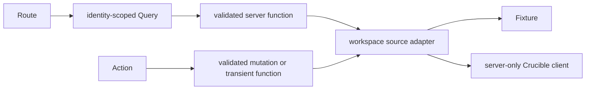

# Authentication Transition

Status: Active migration contract

Date: 2026-09-04

## Scope and current boundary

This document preserves independently testable Hub development during the API-owned login cutover and defines its production gate in [decision 0002](../decisions/0002-server-side-session-boundary.md). The temporary local API-key bridge is development infrastructure only. It must not shape feature APIs, reach browser code, or become production behavior. During this bridge, a browser-session `HttpOnly`, `SameSite=Lax` intent cookie may select the API's explicit global privilege mode. The cookie contains no credential, does not grant authority, and is still checked by the API against the configured human administrator credential on every elevated request. Production moves this intent into the authenticated server-side Hub session.

Fixtures are the default deterministic source. Local API mode is explicit: `HUB_DATA_SOURCE=api` with trusted `CRUCIBLE_API_BASE_URL` and a developer's own user-scoped `CRUCIBLE_API_KEY` in the Hub server environment. The key is read only by server-only code, is never `VITE_`-prefixed or returned through HTML, server functions, hydration, storage, URLs, logs, errors, or telemetry, and is applied only by the generated server client. API mode is rejected in production. Missing or invalid requested API configuration fails closed rather than falling back to fixtures.

Local ORCID mode is explicit: `HUB_DATA_SOURCE=hub-auth`, `CRUCIBLE_API_BASE_URL=https://127.0.0.1:7778/testapi`, and `HUB_AUTH_CLIENT_SECRET` in the Hub server environment. Set `NODE_EXTRA_CA_CERTS` to the local API's trusted certificate before starting Node; never disable certificate verification. The default Hub callback is `http://127.0.0.1:3000/hub/auth/callback`. `HUB_AUTH_CALLBACK_URI` may override it with an exact HTTPS `/hub/auth/callback` URL, and `HUB_AUTH_PUBLIC_API_URL` may provide a distinct browser-reachable HTTPS API base URL while `CRUCIBLE_API_BASE_URL` remains the private server-to-server URL. The API must register and use exactly the same Hub callback, and its ORCID callback must be registered with ORCID. Keep the shared client secret out of git, browser configuration, command output, and chat. Without shared-store configuration, local mode uses process-local sessions and requires signing in again after a Hub restart. Production requires `HUB_AUTH_PRODUCTION_ENABLED=true` and an explicit `HUB_AUTH_SESSION_MODE` of `single-instance` or `redis`. The pilot mode refuses any Redis configuration; Redis mode requires both `HUB_SESSION_REDIS_URL` and `HUB_SESSION_KEYS`.

The shared Hub session path uses `HUB_SESSION_REDIS_URL` and `HUB_SESSION_KEYS` with a single-shard Redis 6.2 or newer service. Production Redis connections require `rediss://`; local development may use `redis://`. `HUB_SESSION_KEYS` is a comma-separated key ring of `id:base64url-encoded-32-byte-key` entries. The first key encrypts new records; all listed keys decrypt existing records. Keep old keys available for at least the 12-hour absolute session lifetime during rotation. Store these settings in managed secrets, restrict Redis network and credentials to the Hub service, and never expose them to browser code or logs. Session records and short-lived login transactions use authenticated encryption and opaque, hashed Redis keys. Sessions expire after 8 hours idle or 12 hours absolute, whichever comes first. Refresh claims are atomic across replicas; a lost or uncertain refresh closes the session rather than retrying a possibly spent token. Callback consumption, cancellation, session creation, administrator-mode rotation, and logout use atomic Redis operations. Shared-store failures must not fall back to local sessions or fixtures.

The pilot uses 2 vCPU, 1 GiB, one minimum and one maximum Cloud Run instance, and best-effort session affinity. Cloud Run can briefly exceed its instance maximum; affinity can break during replacement, deployment, saturation, or traffic changes. Affected users may need to sign in again, including when a login callback reaches another instance. The process-local mode keeps credentials server-side, expires sessions after eight hours idle or twelve hours absolute, and closes sessions after an uncertain token refresh. Do not activate the pilot until cookie, origin, CSRF, refresh, revocation, restart behavior, and the target proxy path are verified. Before allowing more than one configured instance or promising session continuity, deploy and validate the Redis path described in decision 0032. Moving to Redis requires users to sign in again; process-local sessions are not migrated. See [Cloud Run pilot deployment](cloud-run-pilot.md).

When accessing the Hub through Tailscale from another device, a browser redirect to `127.0.0.1` reaches that device rather than the Hub host. For the current Leviathan tailnet name, set the Hub's `HUB_AUTH_PUBLIC_API_URL=https://leviathan.rooster-chimaera.ts.net/testapi` and `HUB_AUTH_CALLBACK_URI=https://leviathan.rooster-chimaera.ts.net/hub/auth/callback`. The API must have matching `HUB_AUTH_PUBLIC_API_URL` and `HUB_AUTH_CALLBACK_URI`, Tailscale Serve must route `/testapi` to the new API process, and ORCID must allow `https://leviathan.rooster-chimaera.ts.net/testapi/auth/hub/callback`. The existing Tailscale Serve root proxy to the Hub alone is insufficient. Keep the Hub's private API URL and certificate trust unchanged for server-to-server calls.

For local sign-in, fill the gitignored `.env.hub-auth.local` with the same client secret configured in the API, then run `set -a; . ./.env.hub-auth.local; set +a; npm run dev` from the Hub root. Do not run the old inline `HUB_DATA_SOURCE=api` command at the same time. Sourcing is required because the server reads unprefixed values from `process.env`, while [Vite's env files expose only prefixed values to application code](https://vite.dev/guide/env-and-mode); [Node reads `NODE_EXTRA_CA_CERTS` only when the process starts](https://nodejs.org/download/release/v22.23.0/docs/api/cli.html). The local file should remain private to its owner and must never be committed.

The Hub starts sign-in with random state and an S256 PKCE verifier stored for ten minutes on the server. The browser receives a short-lived, host-only, `HttpOnly`, `SameSite=Lax` transaction cookie and is redirected to the API login endpoint. The Hub callback consumes the transaction before a server-to-server code exchange, replaces any previous Hub session, and redirects to the validated Hub destination so the one-time code is absent from the destination URL. The browser keeps only an opaque session cookie scoped to `/hub`; its `Secure` attribute follows the configured callback scheme for local HTTP or HTTPS and is required for production HTTPS. The server sends bearer authority and an explicit privilege mode to the API, coordinates refresh per session, and revokes the refresh token on sign-out. The shared-store path keeps administrator-mode intent in the server session and rotates the session ID when that mode changes; local process-only mode retains its browser intent cookie. Sign-out checks the browser's `Origin` against the configured public Hub origin, so a trusted reverse proxy does not turn a valid submission into a 403. It snapshots the refresh token, closes the local session without waiting for any pending refresh, cancels the pending login transaction, clears both auth cookies and administrator mode, and attempts API family revocation with the saved token. It then redirects to the standalone sign-in page with either a signed-out message or an explicit warning that revocation could not be confirmed. A full-page navigation discards the submitting tab's in-memory Query and recently viewed state. A browser tab message sends other open Hub tabs to sign-in immediately, and a server-side session-identity check catches a background tab when it becomes visible, clearing its old account cache if the session ended or changed; neither mechanism writes identity or credential data to browser storage. Logging out of the Hub does not end the separate ORCID session. Failed callbacks log only a categorized reason and, for a rejected token exchange, the HTTP status; they never log callback codes, state, cookies, or tokens. The API-key bridge remains available separately pending an end-to-end sign-in test.

TanStack Start's CSRF middleware now covers every non-safe Hub request method, including server routes, and compares browser origin with the configured public Hub origin in ORCID mode. Logout also requires an exact `Origin` match. Authenticated HTML responses use `Cache-Control: private, no-store`; private server functions set no-store independently. The browser checks account identity and administrator mode when a tab becomes visible or returns from the back-forward cache. The target deployment still needs browser evidence for cookies, headers, cross-tab logout, account replacement, refresh races, and a strict Content Security Policy compatible with TanStack's SSR scripts and the Hub's theme initializer before the production activation setting is enabled.

When a local ORCID session is absent, protected Hub routes redirect to the standalone sign-in page rather than rendering the application shell. The sign-in page uses the [unmodified official ORCID iD icon](https://orcid.org/assets/vectors/orcid.logo.icon.svg) and a full-page redirect, following [ORCID's OAuth sign-in guidance](https://info.orcid.org/documentation/integration-guide/orcid-oauth-sign-in-guidelines/). It presents the ORCID sign-in action and links to ORCID without sending a Hub referrer. The attempted Hub path is validated as a same-origin `/hub/` destination, stored with the short-lived transaction, and restored after sign-in. The current account-profile response has no authenticated ORCID iD field, so the Hub cannot yet render a profile record link under [ORCID's iD display guidance](https://info.orcid.org/documentation/integration-guide/orcid-id-display-guidelines/).

Feature routes, Queries, mutations, and transient actions use browser-safe validated server functions and identity-scoped types. Fixtures and API adapters implement the same feature-facing contract. Read-only development and controlled local mutation proofs may proceed, but routine tests use fixtures and do not call live services. Production authentication and mutation exposure remain blocked until the selected pilot session mode and cutover evidence exist. The API-key bridge must not acquire refresh, rotation, persistence, impersonation, administrator exchange, or browser-login behavior. Contextual Administration uses dedicated elevated server adapters without changing global intent. In process-local mode, the global Administrator view cookie lasts only for the browser session and is removed explicitly when the user returns to standard access; shared mode keeps that intent in the session record.

Direct project membership is implemented in fixture and local API development through this seam. It adds existing users immediately, changes roles, removes members, or allows non-owner self-leave using confirmed server responses. There is no invitation workflow. It remains unavailable in production until the session-authentication gate is satisfied and deployment is approved.

After ORCID sign-in, a session-authenticated account missing email or username is redirected to the standalone `/account/setup` page before entering the workspace. It uses the existing self-service `PATCH /account/profile` operation, preserves a validated Hub return destination, and keeps first and last names optional. The same check applies to an existing account if either required field later becomes empty. A completed account bypasses setup. This is a Hub navigation requirement, not an API-wide completeness guarantee; the API currently permits nullable email and username and does not return an authoritative account-completion flag. Fixture and development API-key modes do not use this gate.

## Stable feature seam

Mutations use Query for pending and error state and change server state only through validated functions. Signed download links and similar transient capabilities bypass Query ownership but not the authentication boundary. Cutover changes only how the server obtains user authority. It must not make routes, components, query keys, feature types, or generated operations credential-aware. After cutover, every private server function authenticates independently; route guards remain user experience, not authorization.

## Target contract

The browser starts login through Hub. Hub creates cryptographically random state and PKCE values, stores a short-lived transaction server-side, and redirects to the API-owned authorization entry. The API owns ORCID nonce handling and returns a short-lived, single-use authorization code to the allowlisted Hub callback. Hub validates the transaction and state, exchanges the code server to server for user authority, stores credential material only in server-side session storage, rotates the session identifier, and sets an opaque `HttpOnly`, `Secure`, `SameSite=Lax` cookie. Shared Redis mode additionally encrypts stored session records and keeps global privilege intent in the server session. Process-local mode currently keeps only non-authoritative administrator intent in a browser cookie, which the API checks against the user's authority. Private functions resolve the session and call the API as the signed-in user. Shared mode rotates the session identifier on privilege activation; expiration, deactivation, logout, account change, or server change removes elevated authority. Logout revokes the server session and clears the cookie. The browser never receives a reusable general API credential.

The pinned API contract now publishes the Hub authorization, token, refresh, and revoke operations, exact redirect registration, and PKCE requirements. End-to-end evidence must still verify code lifetime, single-use and replay behavior, account-disable semantics, safe errors, rate limits, and audit without credential disclosure across the intended environments. Hub does not use an administrator credential to obtain user keys.

Before pilot authentication, Hub must implement the approved one-instance session mode and verify its scaling cap, idle and absolute timeouts, concurrent-session policy, revocation behavior, cookie and proxy policy, same-origin and CSRF enforcement, redacted logging, and browser-safe error mapping. Session expiry and upstream authorization failure are distinct states. Shared storage, its encryption keys, and cross-replica refresh coordination become mandatory before scaling beyond one instance.

## Cutover and evidence

1. Accept and pin the API exchange contract and OpenAPI update where applicable.
2. Record session storage and key-management decisions.
3. Implement server-only transaction, callback validation, code exchange, session creation and rotation, and logout.
4. Authenticate every private server function through shared middleware and resolve API authority from the request session.
5. Add login, callback, logout, expired-session, and unavailable-authentication states.
6. Replace the active Query client whenever server, account, login, or credential identity changes. Include preview Back and Forward restoration in two-account tests.
7. Prove direct private-function enforcement and concurrent two-account server-session and cache isolation, then collect staging evidence.
8. Remove the local API-key bridge, its configuration, documentation, tests, and secret-scan allowances before enabling production authentication.

The pilot gate needs reviewable evidence of state mismatch, missing or expired transaction, replay, and PKCE rejection; exact redirect URI enforcement; session-ID rotation; deployed secure cookie attributes; direct-function authentication; same-origin and CSRF mutation protection; logout, expiry, revocation, disablement, and credential rotation; no credential material in browser artifacts, Query, storage, URLs, logs, telemetry, or screenshots; two-account isolation on the single instance; restart and deployment sign-out behavior; safe API unavailability behavior; and secret-free audit and correlation. Multi-replica sessions, Redis key rotation, and shared-store failure evidence are required before lifting the one-instance cap. The accepted design requires a repository-grounded threat model before production use.

Rollback disables production login and invalidates affected sessions. It never restores process-level API-key mode in production. Fixtures remain available only for permitted controlled development and runtime verification, and local API mode remains separately guarded during a staged cutover.

Migration completes only after normal operation no longer selects `HUB_DATA_SOURCE=api`, `CRUCIBLE_API_KEY` is not a Hub authentication mechanism, bridge-specific documentation, tests, errors, and secret-scan allowances are removed, and roadmap evidence no longer marks the API exchange or session boundary blocked. Fixtures remain test and design data, never authentication fallback.

`crucible-api` owns issuance, user-authority semantics, credential lifecycle, renewal, and revocation. Hub owns login orchestration, sessions, cookie policy, private-function authentication, Query-client isolation, and safe browser errors. Deployment operations own HTTPS termination, proxy trust, session-store availability, and key management. A cross-boundary change updates the API artifact, decision, integration documentation, tests, changelog, and roadmap evidence in the responsible repositories.
